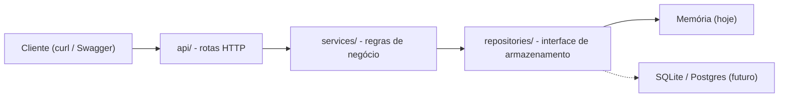

# mini-conta-digital

API REST de **conta digital** feita em Python/FastAPI: criar conta, consultar saldo, depositar, transferir entre contas e consultar extrato.

## Visão geral

| | |
|---|---|
| **O que é** | API REST de conta digital: criar conta, consultar saldo, depositar, transferir e ver extrato |
| **Para que serve** | Estudo: praticar API, testes, Docker, CI e infraestrutura como código |
| **Destaques** | Valores em centavos (inteiros), transferência atômica, idempotência, 41 testes |
| **O que não é** | Um sistema bancário real (sem autenticação, sem banco de dados, sem Pix) |



## Por que este projeto existe

É um **projeto de estudo**, feito em poucas horas para praticar, de ponta a ponta, as peças que cercam uma API:
**API, testes, Docker, CI e infraestrutura como código (Terraform)**.

**Não é um sistema bancário real.** Não há autenticação, banco de dados, Pix, cartões nem nada que se
pareça com um ambiente de produção. A seção [Limitações e próximos passos](#limitações-e-próximos-passos)
diz com franqueza o que falta.

## Stack

Python 3.12+ · FastAPI + Uvicorn · Pydantic · pytest · ruff · Docker · GitHub Actions · Terraform

## Estrutura

```
.
├── app/
│   ├── main.py            # monta a aplicação (create_app)
│   ├── api/               # rotas HTTP e tradução de erros para status
│   ├── services/          # regras de negócio
│   ├── repositories/      # armazenamento (interface + implementação em memória)
│   └── models/            # schemas Pydantic
├── tests/                 # pytest
├── infra/terraform/       # exemplo ilustrativo de IaC (S3)
├── .github/workflows/     # CI
├── Dockerfile
└── docker-compose.yml
```

## Como rodar

### Local

```bash
python3 -m venv .venv
source .venv/bin/activate          # no fish: source .venv/bin/activate.fish
pip install -r requirements-dev.txt
uvicorn app.main:app --reload
```

Documentação interativa (Swagger): <http://127.0.0.1:8000/docs>

### Com Docker

```bash
docker build -t mini-conta-digital:dev .
docker run --rm -p 8000:8000 mini-conta-digital:dev
```

Ou com compose: `docker compose up --build`. A API responde em <http://127.0.0.1:8000/docs>.

### Testes e lint

```bash
pytest                              # 41 testes
ruff check . && ruff format --check .
```

## Endpoints

| Método | Rota | Descrição | Sucesso |
|---|---|---|---|
| `POST` | `/accounts` | Cria conta (saldo inicial 0) | 201 |
| `GET` | `/accounts/{id}` | Consulta conta e saldo | 200 |
| `POST` | `/accounts/{id}/deposits` | Deposita | 201 |
| `POST` | `/transfers` | Transfere entre contas (aceita `Idempotency-Key`) | 201 |
| `GET` | `/accounts/{id}/statement` | Extrato, do mais antigo ao mais recente | 200 |

Erros vêm como `{"detail": "...", "code": "..."}`:

| Situação | Status | `code` |
|---|---|---|
| Conta inexistente | 404 | `account_not_found` |
| Saldo insuficiente | 409 | `insufficient_funds` |
| Transferência para a mesma conta | 422 | `same_account_transfer` |
| `Idempotency-Key` reusada com outro pedido | 422 | `idempotency_key_conflict` |
| Valor zero/negativo/fracionado/texto, UUID malformado | 422 | (erro de validação do FastAPI) |

## Exemplos de requisições (curl)

Valores sempre em **centavos**: `10000` = R$ 100,00.

```bash
BASE=http://127.0.0.1:8000
json() { python3 -c "import sys,json; print(json.load(sys.stdin)['$1'])"; }

# 1) Criar duas contas
ANA=$(curl -s -X POST $BASE/accounts -H 'Content-Type: application/json' \
  -d '{"owner_name": "Ana"}' | json id)
BRUNO=$(curl -s -X POST $BASE/accounts -H 'Content-Type: application/json' \
  -d '{"owner_name": "Bruno"}' | json id)

# 2) Depositar R$ 100,00 na conta da Ana
curl -s -X POST $BASE/accounts/$ANA/deposits -H 'Content-Type: application/json' \
  -d '{"amount_cents": 10000}'; echo

# 3) Consultar conta e saldo
curl -s $BASE/accounts/$ANA; echo

# 4) Transferir R$ 25,00 da Ana para o Bruno (com chave de idempotência)
curl -s -X POST $BASE/transfers -H 'Content-Type: application/json' \
  -H 'Idempotency-Key: pedido-001' \
  -d "{\"from_account_id\": \"$ANA\", \"to_account_id\": \"$BRUNO\", \"amount_cents\": 2500}"; echo

# 5) Repetir o MESMO pedido: devolve a mesma transferência e não debita de novo
curl -s -X POST $BASE/transfers -H 'Content-Type: application/json' \
  -H 'Idempotency-Key: pedido-001' \
  -d "{\"from_account_id\": \"$ANA\", \"to_account_id\": \"$BRUNO\", \"amount_cents\": 2500}"; echo

# 6) Extrato da Ana
curl -s $BASE/accounts/$ANA/statement; echo

# 7) Saldo insuficiente (409)
curl -s -w '\nHTTP %{http_code}\n' -X POST $BASE/transfers -H 'Content-Type: application/json' \
  -d "{\"from_account_id\": \"$ANA\", \"to_account_id\": \"$BRUNO\", \"amount_cents\": 999999}"

# 8) Valor inválido, fracionado (422)
curl -s -w '\nHTTP %{http_code}\n' -X POST $BASE/accounts/$ANA/deposits \
  -H 'Content-Type: application/json' -d '{"amount_cents": 10.5}'
```

## Como funciona uma transferência

Tudo acontece dentro de **um único bloco atômico** (`repository.atomic()`):

1. Recusa na hora se origem e destino forem a mesma conta.
2. Se veio `Idempotency-Key` e ela já foi usada com o mesmo pedido, devolve o resultado guardado e **não move dinheiro**.
3. Busca as duas contas (404 se alguma não existir).
4. Confere o saldo da origem (409 se for insuficiente).
5. Debita a origem, credita o destino, registra as duas linhas do extrato e guarda a chave de idempotência.
6. Se **qualquer** passo falhar, o estado volta ao que era antes (rollback).

## O que os testes cobrem

41 testes com pytest, em três grupos:

- **API (HTTP):** criar conta, depositar, transferir com sucesso, saldo insuficiente, conta inexistente
  (origem e destino), valor inválido (zero, negativo, fracionado, texto, booleano), mesma conta, UUID
  malformado, extrato e idempotência.
- **Atomicidade:** um repositório de teste "quebra" no meio da transferência e o teste confere que saldos,
  extratos e chave de idempotência voltaram ao estado anterior.
- **Concorrência:** 40 transferências simultâneas sobre um saldo que comporta 10; exatamente 10 passam e o
  dinheiro total se conserva.

Também verifiquei que os testes de atomicidade e concorrência **falham** quando removo o rollback e o lock
(mutação feita à mão, fora do repositório), para ter certeza de que não passam por acaso.

## Decisões técnicas

**Dinheiro em centavos, como inteiro.** Números de ponto flutuante não representam decimais com exatidão
(`0.1 + 0.2 != 0.3`), e erros de arredondamento em saldo são inaceitáveis. Inteiros são exatos. Além disso, o
campo é *estrito*: `10.5` ou `"100"` são recusados com 422, em vez de convertidos em silêncio.

**Transferência atômica.** Débito, crédito, registros de extrato e chave de idempotência acontecem dentro de um
único bloco `repository.atomic()`. Se algo falhar no meio, o estado volta ao que era antes: nunca fica "debitou
mas não creditou". É o equivalente a uma transação de banco de dados (`BEGIN … ROLLBACK`). Há um teste que
força uma falha no meio da transferência para provar isso.

**Lock contra concorrência.** O FastAPI atende requisições em várias threads. Um lock garante que apenas uma
operação "ler saldo → alterar → gravar" aconteça por vez, evitando que duas transferências simultâneas gastem
o mesmo saldo. Um teste dispara 40 transferências concorrentes sobre um saldo que comporta 10 e confere que
exatamente 10 passam.

**Camadas simples.** `api` (HTTP) → `services` (regras) → `repositories` (dados) + `models` (formatos). O
serviço não sabe de HTTP e não sabe onde os dados ficam. Isso permite testá-lo isoladamente e trocar a
memória por SQLite/Postgres escrevendo outra classe que implemente `AccountRepository`, sem tocar em rotas
nem regras.

**Idempotência na transferência.** Com `Idempotency-Key`, repetir o mesmo pedido (por exemplo, após um
timeout) devolve o resultado original sem mover dinheiro de novo. A mesma chave com um pedido diferente
retorna 422. Tentativas que falharam não "consomem" a chave.

**Códigos HTTP.** 404 para conta inexistente; 409 para saldo insuficiente (pedido válido que conflita com o
estado atual); 422 para dados inválidos.

**Docker.** Imagem `python:3.12-slim`, usuário sem privilégios (não roda como root) e dependências em uma
camada separada do código, para o Docker reaproveitar o cache quando só o código muda.

**CI.** O workflow em `.github/workflows/ci.yml` roda a cada push e pull request: instala dependências,
`ruff check`, `ruff format --check` e `pytest`.

**Terraform (ilustrativo).** Em `infra/terraform/`, um bucket S3 com bloqueio de acesso público,
versionamento e criptografia, com variáveis validadas e outputs. A API **não usa** esse bucket. Foi validado
com `terraform fmt` e `terraform validate`; o `plan` foi feito de forma offline (credenciais falsas e
`skip_*`, fora do repositório), pois não há conta AWS configurada. **Nenhum `apply` foi executado.**

```bash
cd infra/terraform
terraform init -backend=false
terraform fmt -check
terraform validate
```

## Limitações e próximos passos

Este projeto é deliberadamente pequeno. Limitações conhecidas:

- **Sem autenticação nem autorização.** Qualquer um que alcance a API move dinheiro de qualquer conta.
- **Sem banco de dados real.** Tudo fica em memória e some ao reiniciar. Só funciona com **uma** instância.
- **Concorrência pouco robusta.** O lock protege apenas dentro de um processo e é global (uma operação por
  vez). Com várias instâncias, seria preciso um banco com transações e controle de concorrência.
- **Idempotência simples.** As chaves ficam em memória, sem expiração, e valem globalmente (não por cliente).
- **Extrato sem paginação** e sem filtros.
- **Regras bancárias reais ausentes:** limites, moedas, tarifas, antifraude, conciliação, auditoria.
  Não há Pix, cartões nem integrações.
- **Terraform apenas ilustrativo:** nunca foi aplicado, o estado seria local e não há backend remoto.
- **Docker básico:** sem `HEALTHCHECK` e com um único processo do Uvicorn.
- **CI sem entrega (CD):** só valida o código; não publica imagem nem faz deploy. Também não há verificação
  estática de tipos (ex.: `mypy`), apesar de o código ser todo anotado.
- **Observabilidade mínima:** sem logs estruturados, métricas ou tracing.

Próximos passos naturais:

1. Persistência em SQLite e depois Postgres, usando transações reais (implementando `AccountRepository`).
2. Autenticação (por exemplo, JWT) e contas vinculadas a usuários.
3. `mypy` no CI e publicação da imagem Docker em um registry.
4. Paginação do extrato e expiração das chaves de idempotência.
5. Backend remoto e módulos no Terraform; `HEALTHCHECK` no Docker.

## Como foi construído

Desenvolvi o projeto em etapas, com **um commit por etapa** (veja o histórico): API e testes, Docker, CI,
Terraform e README. Usei o **Claude Code** (assistente de programação com IA) como apoio e para me explicar
cada decisão; os commits trazem a marca de coautoria. O objetivo era aprender, então a prioridade foi
entender e conseguir explicar cada peça, e não acumular funcionalidades.

## Problemas que encontrei e como resolvi

- **Lint falhando por linhas longas.** Eu havia encadeado `ruff check && ruff format`, então o `format`, que
  corrige isso sozinho, nunca rodava. Solução: rodar o `format` primeiro e quebrar à mão uma string longa.
- **Testes passando de primeira.** Em vez de confiar, quebrei o código de propósito (sem rollback, sem lock)
  para ver os testes falharem. Falharam, então testam o que dizem testar.
- **Docker "não conecta".** O cliente estava instalado, mas o serviço (daemon) estava desligado. Precisei
  ligá-lo com `systemctl`.
- **`terraform plan` sem conta AWS.** Falha com `No valid credential sources found`. Fiz o plano offline
  numa cópia fora do repositório, com credenciais falsas e `skip_*`, e deixei isso explícito aqui.
- **Status do CI enganoso.** A CLI do GitHub mostrou `queued` para uma execução que já tinha terminado.
  O log é que mostrou o resultado real: status é um dado, o log é a prova.

## O que aprendi

<!-- RASCUNHO: ajuste com as suas palavras antes de usar. -->

- **Camadas.** Separar rotas, regras de negócio e armazenamento permite testar as regras sem HTTP e trocar
  a memória por um banco escrevendo outra classe, sem mexer no resto.
- **Dinheiro e consistência.** Em sistemas financeiros, usar inteiros em centavos, garantir que a
  transferência seja atômica e tratar requisições repetidas (idempotência) pesa mais do que ter muitas
  funcionalidades.
- **Testes de verdade.** Escrever o teste não basta; vale quebrar o código de propósito para ver se o teste
  falha. Também vi como simular uma falha no meio de uma operação.
- **Docker.** A diferença entre imagem e container, e entre container e máquina virtual (o container
  compartilha o kernel do host). Aprendi que a ordem das instruções do Dockerfile decide o aproveitamento
  do cache, e por que rodar como usuário sem privilégios.
- **CI.** Integração contínua é uma máquina limpa que, a cada push, instala, testa e avisa se algo quebrou,
  o que revela o "na minha máquina funciona". Descrevi isso em um workflow do GitHub Actions.
- **Infraestrutura como código.** Descrever recursos em arquivos versionados, usar `validate` e `plan` para
  conferir antes de qualquer mudança, e não versionar estado nem segredos.
- **Honestidade sobre o escopo.** Este é um primeiro contato prático com Docker, CI e Terraform, e **não**
  experiência de produção. Prefiro dizer o que falta a exagerar o que fiz.
